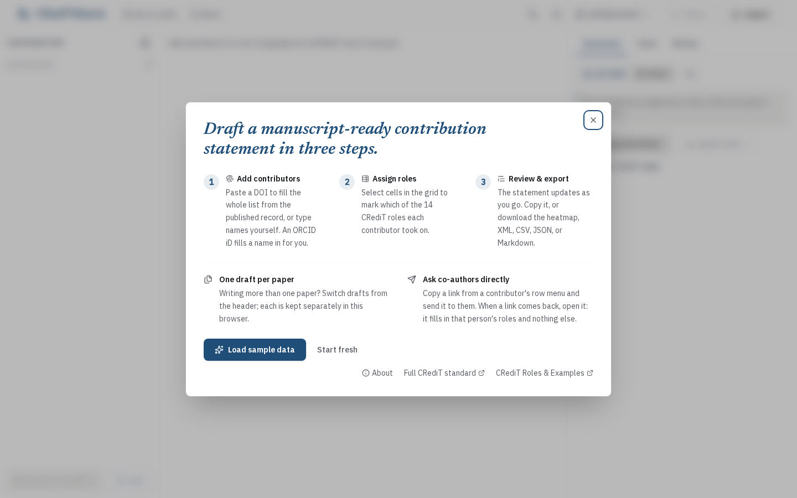
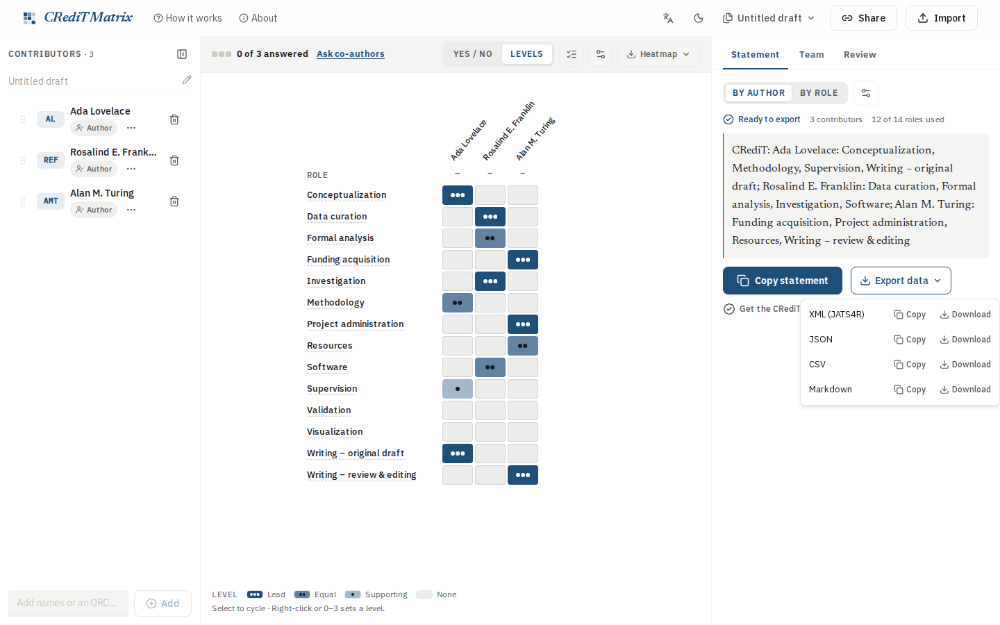

# CRediT Matrix

[](https://github.com/simonvanlierde/credit-matrix/actions/workflows/ci.yml)
[](https://codecov.io/gh/simonvanlierde/credit-matrix)
[](https://credit.duinlab.nl)
[](https://doi.org/10.5281/zenodo.21213659)
[](LICENSE)
[](CONTRIBUTING.md)

A web app for writing the contribution statement of a paper: who did what, in the 14 roles of
[CRediT (Contributor Roles Taxonomy)](https://credit.niso.org/). It was released as
*CRediT Generator* before.

Add your contributors, give each of them their roles, and copy a statement you can paste into the
manuscript. The same grid is a **contribution heatmap** you can export as a figure. It also exports
files for journal submission systems: JATS4R XML, CSV, JSON, and Markdown. JATS is the XML format
journals use for articles, and JATS4R is a set of recommendations on how to use it.

CRediT Matrix is an independent project. It is not affiliated with or endorsed by NISO.

**Try it:** [credit.duinlab.nl](https://credit.duinlab.nl)


## What it does

- **Contributors**: add, rename, reorder, or paste a whole author list. Paste an ORCID iD (a
  researcher's own identifier) or URL to look up the name. Paste a DOI (a paper's permanent
  identifier) to fill the whole list from the published record
- **Ask your co-authors**: send each person a link addressed to their own row, either blank or
  with your guess for them to check. The link opens a co-author page made for a phone, where they
  pick a level per role and send the link back. When you open the reply, their answer sits beside
  your row and does not overwrite it. You settle each difference in the Review tab, and you can undo
  each choice on its own. The Team tab shows who you asked and who answered
- **Drafts**: one per paper, switched from the header. They stay in this browser, open tabs follow
  each other's changes, and **Delete all drafts** clears them
- **Contribution grid**: select a cell to give someone one of the 14 roles, as yes/no or as a
  contribution level. The grid is also the heatmap, so you can transpose it, swap initials for full
  names, and recolor it
- **Statements**: group by role or by author, with full names or initials, and optional level
  labels. Copy as rich text or plain, and mark shared first authorship and corresponding authors
- **Nine languages**: the interface and the generated statement each pick their own language, so a
  Dutch interface can produce an English statement. Role names come from
  [credit-translation](https://github.com/contributorshipcollaboration/credit-translation). Exports
  meant for software keep the official English CRediT terms
- **Exports**: copy or download JATS4R XML, CSV, JSON, and Markdown, or download the heatmap as SVG
  or PNG. The JSON file also carries your co-authors' answers. The JATS export is checked against
  a [conformance suite](conformance/README.md) that other tools can reuse
- **Sharing and import**: encode a draft in a URL, paste names, or import JSON, CSV, JATS4R XML,
  or a [tenzing](https://github.com/marton-balazs-kovacs/tenzing) spreadsheet saved as CSV.
  Importing a JSON file into the same draft brings the co-authors' answers back
- **Works offline**: install it, and you can keep working on a flight. Only the ORCID and DOI
  lookups need a network
- **Accessibility**: aims to meet WCAG 2.2 AA. The [accessibility statement](docs/accessibility.md)
  says how that is checked, what is known not to work yet, and how to report a problem

| First run | Statement & export |
|---|---|
|  |  |

## Use the package

The app's statements and file formats are also a TypeScript package,
[`credit-matrix`](src/core/README.md), for Node and the browser:

```bash
npm install credit-matrix
```

```ts
import { readFile } from "node:fs/promises";
import { generateStatement, importAny } from "credit-matrix";

const { authors } = await importAny(await readFile("contributions.csv", "utf8"));
console.log(generateStatement(authors, { format: "by-author" }));
```

It reads and writes JSON, CSV, JATS4R XML and Markdown, draws the heatmap SVG, and builds ask
links. Its CLI does the same from a shell:

```bash
npx credit-matrix statement contributions.json --format by-author --locale nl
```

A `<credit-matrix>` element shows a statement and heatmap on any web page: see
[docs/element.md](docs/element.md).

## Use it in your manuscript

Quarto and MyST already let you record CRediT roles for each author in the front matter. Two small
add-ons turn those roles into a CRediT statement in the document:

- [Quarto extension](integrations/quarto/README.md): `quarto add
  simonvanlierde/credit-matrix/integrations/quarto`, then `filters: [credit-matrix]`.
- [MyST plugin](integrations/myst/README.md): a `{credit-statement}` directive.

---

## Architecture

It's all TypeScript: one Next.js app, with the logic that doesn't depend on React or Next.js in
`src/core`.

| Layer | Choice | Why |
|---|---|---|
| Frontend | Next.js 16 (App Router) | Static export on Cloudflare, no server code |
| Styling | Tailwind CSS v4 | Design tokens via `@theme`; no runtime CSS |
| State | Zustand + immer + persist | Survives a refresh via localStorage |
| Validation | Zod | Schema checks at trust boundaries |
| Heatmap | Hand-crafted SVG (`core`) | One SVG source feeds both download and canvas PNG |
| Offline | Service worker + manifest | Precaches the app's own files under a per-build cache name |

```text
Browser
  └─ Next.js app  (repo root, App Router)
       ├─ React UI + Zustand store (persisted to localStorage)
       ├─ src/core   ← all domain logic, runs in the browser
       │     statements · JATS4R XML · CSV · JSON · Markdown · heatmap SVG · validation
       └─ ORCID and DOI lookups ──→ pub.orcid.org · api.crossref.org · api.datacite.org
                                     ← the only calls that leave the browser
```

Everything runs in the browser. The site is a static export, so there is no server code.
[`src/core`](src/core/README.md) holds the domain logic as plain TypeScript, and `zod` is its only
runtime dependency. It is also published as the `credit-matrix` package. XML import uses the
browser's own `DOMParser`. The PNG is drawn from the heatmap SVG onto a `<canvas>`.

The ORCID and DOI lookups call the public APIs of ORCID, Crossref and DataCite straight from the
browser. DataCite is only asked about DOIs that Crossref does not hold, such as arXiv and Zenodo
records. All three send CORS headers that let the browser call them. The Content Security Policy
(CSP) in [`public/_headers`](public/_headers) allows exactly those origins.

Each contribution stores a 0–100 integer `score`, not a yes/no value. That way the UI can switch
between yes/no and levels without changing what is stored. See
[`src/core/README.md`](src/core/README.md#domain-model) for the score range of each level.

**No accounts, no server-side storage.** A draft holds the names and ORCID iDs of co-authors who
never visited this site. So the draft stays in your browser, and I have nothing to delete when
someone asks. To move a draft to another device, export it as JSON.
[ADR 0002](docs/adr/0002-no-accounts-or-server-side-storage.md) says what would have to change
before I revisit this.

---

## Self-hosting

**Prerequisites:** Node ≥ 26, pnpm ≥ 11

```bash
git clone https://github.com/simonvanlierde/credit-matrix
cd credit-matrix
pnpm install
pnpm dev            # → http://localhost:3000
```

[CONTRIBUTING.md](CONTRIBUTING.md) has all the commands and the checks to run before a pull request.

### Deployment

`pnpm build` writes a static export to `out/`, and any static host can serve it. The response
headers, including the CSP, are in [`public/_headers`](public/_headers). The live site serves the
export as Cloudflare Workers static assets, with no Worker code.

[CI](.github/workflows/ci.yml) runs on pull requests and on pushes to `main`. It lints, typechecks,
runs the unit and end-to-end tests, and builds the site. On `main`, once all of that passes, GitHub
Actions deploys the build it tested. A pull request gets a preview version that does not go live.
[docs/deploy.md](docs/deploy.md) has the details and the one-time setup.

Pushing a `v*` release tag also publishes the `credit-matrix` package to npm, through
[release-core.yml](.github/workflows/release-core.yml). The one-time npm setup is in
[docs/deploy.md](docs/deploy.md#the-npm-package).

To host it on Cloudflare yourself, set your own domain in [wrangler.jsonc](wrangler.jsonc):

```bash
pnpm preview        # build + serve out/ locally, headers applied
pnpm deploy         # build + deploy to your Cloudflare account
```

`pnpm build` runs `next build`, then [`scripts/postbuild.mjs`](scripts/postbuild.mjs). That script
replaces `'unsafe-inline'` in the CSP with the hashes of the exported inline scripts. It also names
the service worker's cache after the build. To roll back a bad deploy, see
[docs/deploy.md](docs/deploy.md#roll-back).

## Roadmap

- **Review the translations.** Besides English, the interface ships in eight languages, all
  machine-translated. `e2e/messages.spec.ts` checks that each catalog has the same keys as English,
  balanced ICU braces, intact placeholders, and product and format names left untranslated. But no
  native speaker has read the text yet. Japanese and Chinese need one most, because the word for
  a contribution *statement* is not settled there.
- **Add more languages.** Eight translated languages ship today (de, es, fr, it, ja, nl, pt-PT,
  zh-Hans). They are a hand-picked subset of
  [credit-translation](https://github.com/contributorshipcollaboration/credit-translation), copied
  into [`src/core/credit-i18n/translations`](src/core/credit-i18n/translations).
  Refresh them with `node scripts/fetch-credit-translations.mjs`.
- **Read more from ORCID.** The lookup only takes the name. Affiliation is the next field
  submission systems ask for.

## Contributing

Bug reports and small features are welcome. See [CONTRIBUTING.md](CONTRIBUTING.md) for setup,
testing, and the accessibility checks. [PRODUCT.md](PRODUCT.md) says what the app is for and who
it's for. [DESIGN.md](DESIGN.md) holds the design rules that UI changes have to follow. I record
design decisions as architecture decision records, in [docs/adr](docs/adr/).

## Acknowledgements

CRediT Matrix builds on earlier tools and research on who gets credit for what in a paper:

- The original
  [Python/Dash CRediT Generator](https://github.com/IPHYS-Bioinformatics/CRediT-Generator), which
  inspired this app.
- Role translations from
  [credit-translation](https://github.com/contributorshipcollaboration/credit-translation).
- The **contribution matrix** proposed by Nick Steinmetz (2019), which this app's heatmap descends
  from. *Nature Index* surveys it in
  ["Researchers are embracing visual tools to give fair credit…"](https://www.nature.com/nature-index/news/researchers-embracing-visual-tools-contribution-matrix-give-fair-credit-authors-scientific-papers).

### Related work

- Brand, A., Allen, L., Altman, M., Hlava, M., & Scott, J. (2015). Beyond authorship: attribution,
  contribution, collaboration, and credit. *Learned Publishing, 28*(2), 151–155.
  <https://doi.org/10.1002/leap.1210>
- Holcombe, A. O., Kovács, M., Aust, F., & Aczel, B. (2020). Documenting contributions to scholarly
  articles using CRediT and tenzing. *PLOS ONE, 15*(12), e0244611.
  <https://doi.org/10.1371/journal.pone.0244611>
- Nakagawa, S., Ivimey-Cook, E. R., Grainger, M. J., O'Dea, R. E., et al. (2023). Method Reporting
  with Initials for Transparency (MeRIT) promotes more granularity and accountability for author
  contributions. *Nature Communications, 14*, 1788. <https://doi.org/10.1038/s41467-023-37039-1>
- Holcombe, A. O., Kovacs, M., Lagisz, M., et al. (2026). Facilitating multilingual research
  publishing: Translations of the Contributor Roles Taxonomy (CRediT). *MetaArXiv*.
  <https://doi.org/10.31222/osf.io/2rp7s_v2>

## Citing this software

If you use CRediT Matrix in your work, please cite it. The citation details are in
[CITATION.cff](CITATION.cff), and GitHub's "Cite this repository" button turns them into APA and
BibTeX. The archived releases are on Zenodo:
[doi:10.5281/zenodo.21213659](https://doi.org/10.5281/zenodo.21213659).

> van Lierde, S. *CRediT Matrix* [Computer software]. Zenodo.
> <https://doi.org/10.5281/zenodo.21213659>

## License

[MIT](LICENSE) © Simon van Lierde

The bundled fonts, IBM Plex and Newsreader, are under the SIL Open Font License:
[IBM Plex](public/fonts/OFL-ibm-plex.txt), [Newsreader](public/fonts/OFL-newsreader.txt).
