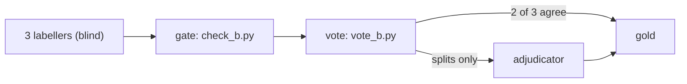

# Definition-B labelling

Definition B says which author did which CRediT role, as the statement says it. The statement can
use the CRediT names or its own words. Each claim is tied to an exact quote and marked with how
directly the statement made it. The rules, the role mapping table and the edge cases are in
[definition-b.md](definition-b.md). Read that file before you label anything.

## Label format

One JSON object per row. A statement that says nothing about who did what gets `"label": []`.

```json
{"pmcid": "PMC0000001", "label": [
  {"quote": "LV designed the study and wrote the first draft",
   "mentions": ["LV"], "authors": [1],
   "roles": [{"role": "methodology", "evidence": "worded"},
             {"role": "writing - original draft", "evidence": "worded"}]},
  {"quote": "All authors meet the ICMJE authorship criteria",
   "mentions": ["All authors"], "authors": [1, 2, 3], "pledge": "icmje"}
]}
```

`evidence` is `named`, `worded` or `inferred`. `labels.check_label` in `src/census/labels.py`
checks the format.

## The three views

One label gives three sets of (author, role) pairs:

- **strict**: only roles with `named` evidence.
- **general**: roles with any evidence. This is the default and the view we train and score on.
- **generous**: general, plus every pledge read as the ICMJE roles. It is an upper bound only.
  Do not train on it: few of the pairs it adds match a publisher's tags.

The format of a statement follows from the evidence. It is `credit` when at least half the roles
are named, `narrative` when fewer are, `icmje` when there are only pledges, and `none` otherwise.

## Scripts

Run them from the `census` folder with `.venv/bin/python`. Data lives in `data/labels`, which
is not tracked.

| Script | What it does |
| --- | --- |
| `labelling/pilot_b.py` | Draws the 200-row pilot: 100 narrative rows and 100 rows with roles. Writes `oa-2026-10-pilot200b.csv` and its `-key.csv`. |
| `labelling/check_b.py INPUT.csv PART.jsonl [FIRST COUNT \| partial]` | The gate. Checks every label in a labeller's file. Prints each fault and exits 1, or prints `ok N`. |
| `labelling/vote_b.py NAME` | Takes the three labellers' files, prints their agreement, writes the rows with no majority to `NAME-splits.jsonl`, and builds `NAME-gold.jsonl` once `NAME-adjudicated.jsonl` covers every split. |
| `labelling/label-workflow.js` | Runs the whole pipeline as an agent workflow. Pass `census`, the absolute path of this folder, in its args. |

## Pipeline



Each labeller works alone and does not see the others' files. The gate refuses any label with a
quote that is not in the statement or with a bad author number. The vote keeps a label that two
labellers gave in full. Only the rows with three different labels go to the adjudicator.

## Pilot gate

Run the pilot before a full labelling run. It passes when two things hold:

1. Exact agreement between labellers is at least 0.80 on the narrative rows.
2. The project owner checks 40 rows by hand and marks at least 34 of them right.

## Where the examples live

The 16 worked examples that the labellers read, with a `why` for each, are in
`data/labels/defB-worked-examples.jsonl`. They come from published articles, so the file is not
published. It stays in the gitignored data folder.
