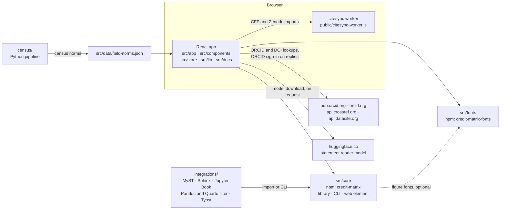

# Architecture

Last reviewed: 2026-11-15

The web app is TypeScript: one React app, built with Vite and prerendered to static HTML. The logic
that doesn't depend on React lives in `src/core`, published to npm as `credit-matrix`, and the figure
fonts in `src/fonts`, published as `credit-matrix-fonts`. There is no server code. Beside the app,
`census/` is a Python project that measures how papers use CRediT, and `integrations/` holds the
plugins for writing tools.

| Layer | Choice | Why |
|---|---|---|
| Frontend | React 19 + Vite 8 | Static export on Cloudflare, no server code |
| Styling | Tailwind CSS v4 | Design tokens via `@theme`; no runtime CSS |
| State | Zustand + immer + persist | Survives a refresh via localStorage |
| Validation | Zod | Schema checks at trust boundaries |
| Translation | Lingui, PO catalogs in `src/locales` | A standard catalog format that translation checks read |
| Heatmap | SVG and embedded-font renderer (`core`) | One SVG source feeds SVG, PDF and canvas PNG exports |
| Offline | Service worker + manifest | Precaches the app's own files under a per-build cache name |

The lookups to ORCID, Crossref and DataCite, and the statement reader's model download from the
Hugging Face Hub, are the only calls that leave the browser.

## `src/core`

[`src/core`](../src/core/README.md) holds the domain logic (statements, exports, validation, heatmap
SVG/PDF) as plain TypeScript with no side effects, with `zod` for validation and Lingui for translation. It is
published as the `credit-matrix` npm package, with a CLI (`cli.ts`) and a web element
(`element.ts`). Apart from the CLI, it uses no React or Node APIs when it's imported. Biome
refuses imports there of React, next-themes, `@/`, or relative paths that leave `src/core`. Most changes
and most tests go here. XML import uses the browser's own `DOMParser`; the CLI bundles linkedom in its place. The PNG is drawn from the
heatmap SVG onto a `<canvas>`. [`figures.ts`](../src/core/figures.ts) embeds fonts in SVG and PDF;
the [figure font guide](../integrations/figures/README.md) describes coverage and offline use.

Each contribution stores a 0–100 integer `score`, not a yes/no value, so the UI can switch between
yes/no and levels without changing what is stored. The
[domain model](../src/core/README.md#domain-model) has the score range of each level.
[ADR 0001](adr/0001-client-side-architecture.md) explains the split.

## `src/fonts`

[`src/fonts`](../src/fonts/README.md) holds the Noto faces and the HarfBuzz WebAssembly that heatmap
SVG and PDF exports embed. The app imports it, so the bundler serves each face from this site.
Without it, `credit-matrix` downloads the faces once from jsDelivr and checks them against hashes
pinned in [`figure-fonts.ts`](../src/core/figure-fonts.ts).

## `integrations` and `census`

[`integrations`](../integrations) holds one folder per writing tool. MyST and Sphinx call the
package or its CLI; the Pandoc and Quarto Lua filter and the Typst package reimplement the statement
wording, and their tests check it against `src/core`. RO-Crate, CodeMeta and figures are guides to
the CLI's exports. The Python tests run with `pnpm test:integrations`.

[`census`](../census/README.md) is a separate uv project that reads open-access JATS articles. Its
`norms` command writes [`src/data/field-norms.json`](../src/data/field-norms.json), which the norms
panel shows. [`statement.ts`](../src/core/statement.ts) is a port of the census statement parser,
and a parity test runs both over the same corpus.

## Documentation

The `/docs` pages render the integration READMEs at build time. The browser receives navigation
metadata and prerendered HTML, without the Markdown sources or renderer. A standalone
`<!-- live: quarto -->` comment inserts a live example; pages without a marker never load that code.
Each example shows one export, from the current draft in this browser or from sample contributors.
The visible source switch changes only the example, leaving the saved draft unchanged. Static
instructions remain readable when JavaScript or a live example cannot load.

Pagefind builds the English search index from prerendered documentation, before the single postbuild
pass stamps the CSP and service worker. Search uses the build id as its metadata cache tag, so offline
queries use the same index as the page. The first docs visit caches search, the docs page chunk,
and the visited page; app installation does not download documentation or the search index.

## Lookups and the CSP

The ORCID and DOI lookups call the public APIs of ORCID, Crossref and DataCite straight from the
browser. DataCite is only asked about DOIs that Crossref does not hold, such as arXiv and Zenodo
records. All three send CORS headers that let the browser call them. The Content Security Policy
(CSP) in [`public/_headers`](../public/_headers) allows exactly those origins, plus `orcid.org`, whose
public keys check a co-author's ORCID sign-in on a reply, and `huggingface.co` with its `*.hf.co` CDN
for the statement reader. That reader (`src/lib/statement-reader.ts`) runs the census model, int8
ONNX, in a worker through transformers.js on onnxruntime-web's CPU build, whose WebAssembly this
site serves. It loads when someone asks for it, never at install; transformers.js caches the model
in its own Cache Storage entry, which the service worker leaves alone.

Citation files in CFF or Zenodo format are converted locally by a citesync worker that loads on
first use. The build copies the pinned Pyodide runtime from
`node_modules/pyodide` into `/citesync/pyodide/` and downloads checksum-verified Python wheels
(`scripts/vendor-citesync.mjs`); the worker's CSP allows only this site. The service worker caches the
runtime on first use, so later citation imports work offline until the next deploy; the build id
hashes the runtime files, so a new converter never mixes with a cached old one. CodeMeta imports
need no runtime and work offline.

## No accounts, no server-side storage

A draft holds the names and ORCID iDs of co-authors who never visited this site. So the draft stays
in your browser, and I have nothing to delete when someone asks. To move a draft to another device,
export it as JSON. [ADR 0002](adr/0002-no-accounts-or-server-side-storage.md) says what would have
to change before I revisit this.
