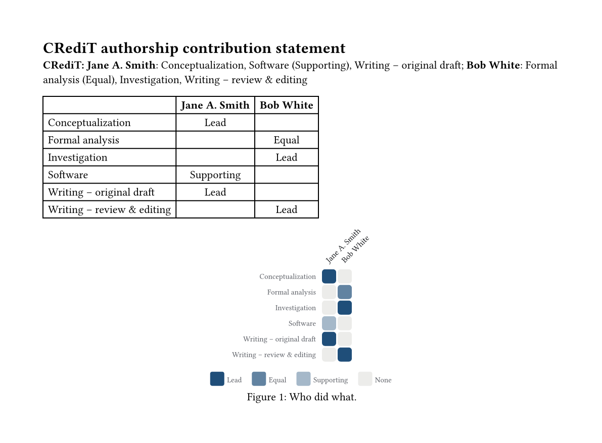

# credit-matrix

Write a [CRediT](https://credit.niso.org/) authorship statement in Typst, with a role-by-contributor
table and heatmap. The wording, levels and translations are the same as in the
[CRediT matrix app](https://github.com/simonvanlierde/credit-matrix), so you can plan the roles in
the app, export them as JSON and print them in your paper.

## Install

Once the package is on Typst Universe:

```typ
#import "@preview/credit-matrix:0.1.0": *
```

Until then, copy this folder (`lib.typ`, `translations.json`, `typst.toml`) into your project and
import `lib.typ`:

```typ
#import "credit-matrix/lib.typ": *
```

Or install it as a local package by copying the folder to
`{data-dir}/typst/packages/local/credit-matrix/0.1.0/` and importing
`@local/credit-matrix:0.1.0` ([where `{data-dir}` is](https://github.com/typst/packages#local-packages)).

Needs Typst 0.14 or later.

## Use

```typ
#let team = (
  (name: "Jane A. Smith", roles: (conceptualization: "lead", software: "supporting", writing-original-draft: true)),
  (name: "Bob White", roles: (investigation: true, formal-analysis: "equal", writing-review-editing: true)),
)

#credit-statement(team, levels: true)
```

renders as:

> **CRediT: Jane A. Smith**: Conceptualization, Software (Supporting), Writing – original draft;
> **Bob White**: Formal analysis (Equal), Investigation, Writing – review & editing



### Contributors

An array of dictionaries, one per person:

- `name`: the name as printed.
- `roles`: a dictionary from role to level, or an array of roles (each one `"lead"`). A level is
  `"lead"`, `"equal"`, `"supporting"`, `true` (lead), `false` or `"none"` (left out), or a whole
  score from 0 to 100 (1 to 33 is supporting, 34 to 66 equal, 67 and up lead).
- `non-author: true` credits the person on an Acknowledgements line instead.
- `equal-contribution: true` and `corresponding: true` add the notes the app adds: "A and B
  contributed equally to this work." and "Correspondence: A."

Roles are the slugs of the [CRediT role pages](https://credit.niso.org/): `conceptualization`,
`data-curation`, `formal-analysis`, `funding-acquisition`, `investigation`, `methodology`,
`project-administration`, `resources`, `software`, `supervision`, `validation`, `visualization`,
`writing-original-draft`, `writing-review-editing`. An unknown role stops the build with a message
that names it.

You can also pass the app's own export: Export data, JSON, then

```typ
#credit-statement(json("team.json"))
```

### Functions

- `credit-statement(contributors, format: "by-author", levels: false, lang: auto)`: the statement,
  one paragraph for the authors, one for the acknowledged contributors and one per note. `format`
  is `"by-author"` (Jane: Software, Validation) or `"by-role"` (Software: Jane, Bob). With
  `levels: true`, Equal and Supporting are shown after each role or name; Lead is not.
- `credit-statement-text(..)`: the same statement as a plain string, with the same arguments. Call
  it inside `context` when `lang` is `auto`.
- `credit-table(contributors, levels: true, lang: auto, marks: auto)`: a table with a row per role
  and a column per person. A cell shows the level, or a check mark with `levels: false`. Pass
  `marks: (lead: [L], equal: [E], supporting: [S])` for marks of your own.
- `credit-heatmap(contributors, levels: true, lang: auto, color: rgb("#1f4e79"), cell: 14pt,
  gap: 1.5pt, ..)`: the app's heatmap, as a figure. Other named arguments, such as `caption`, go
  to `figure`. Its alt text is the statement, so a screen reader in a tagged PDF reads who did
  what.

Only roles someone holds are shown, in the CRediT order.

### Languages

`lang: auto` follows the document's `#set text(lang: ..)`. Role names come from the
[community CRediT translations](https://github.com/contributorshipcollaboration/credit-translation)
in English, French, German, Spanish, Italian, Portuguese (`pt`, Portugal), Dutch, Chinese (`zh`,
simplified) and Japanese. Any other document language falls back to English; an explicit `lang`
the package lacks stops the build. The "CRediT:" prefix stays English, as in the app.

Examples: [a document with inline roles](examples/basic.typ) and
[one that reads a JSON export in French](examples/team.typ).

### Accessible PDFs

Give the document a title (`#set document(title: [..])`) so `--pdf-standard ua-1` passes. For a
tagged PDF, put the table in a figure with a caption, as Typst 0.15 cannot mark row headers:

```typ
#figure(credit-table(team), caption: [Contributions by role.])
```
